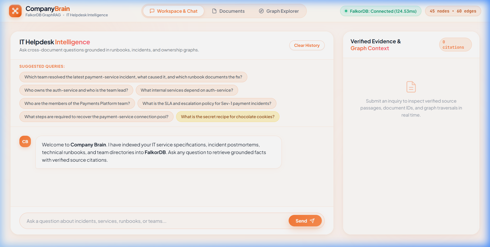
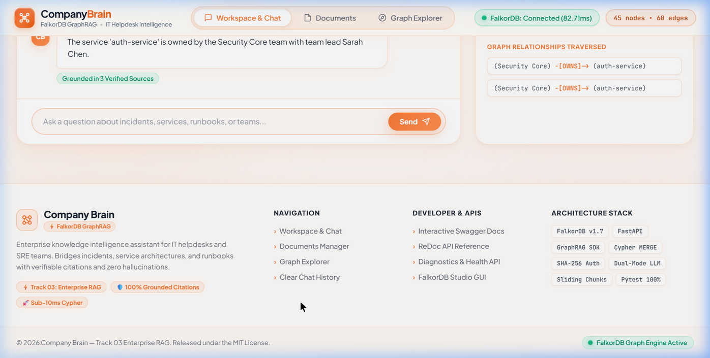
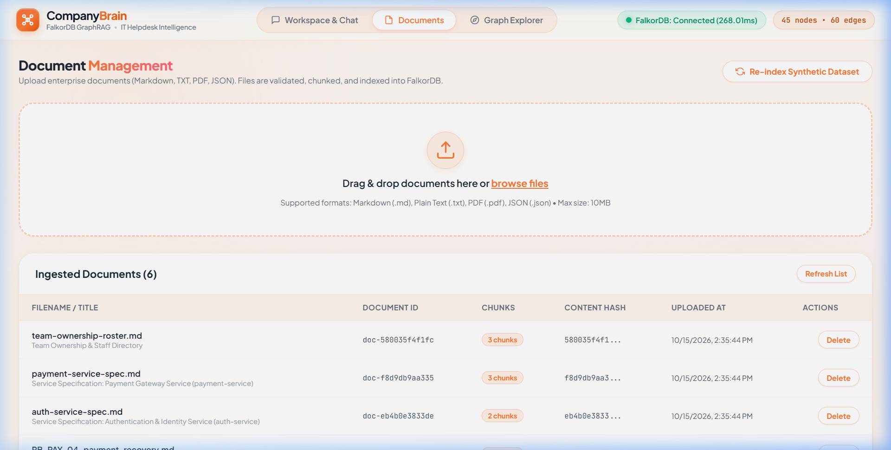
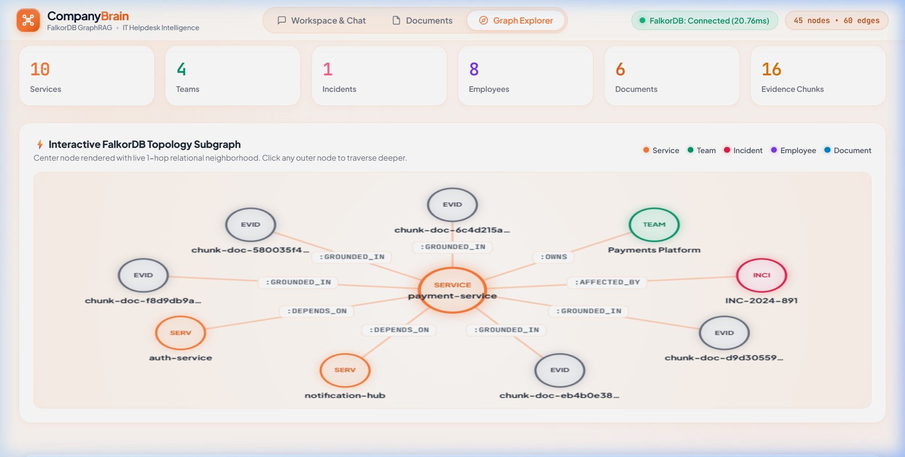
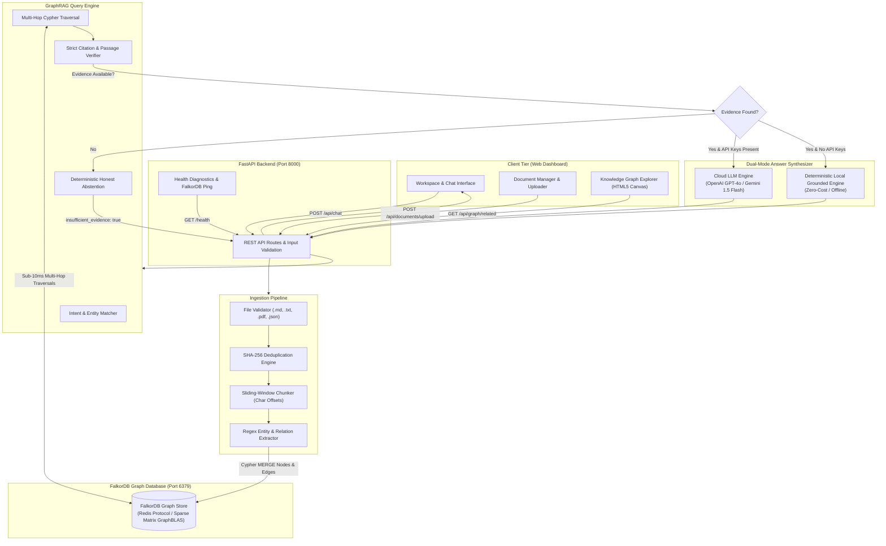
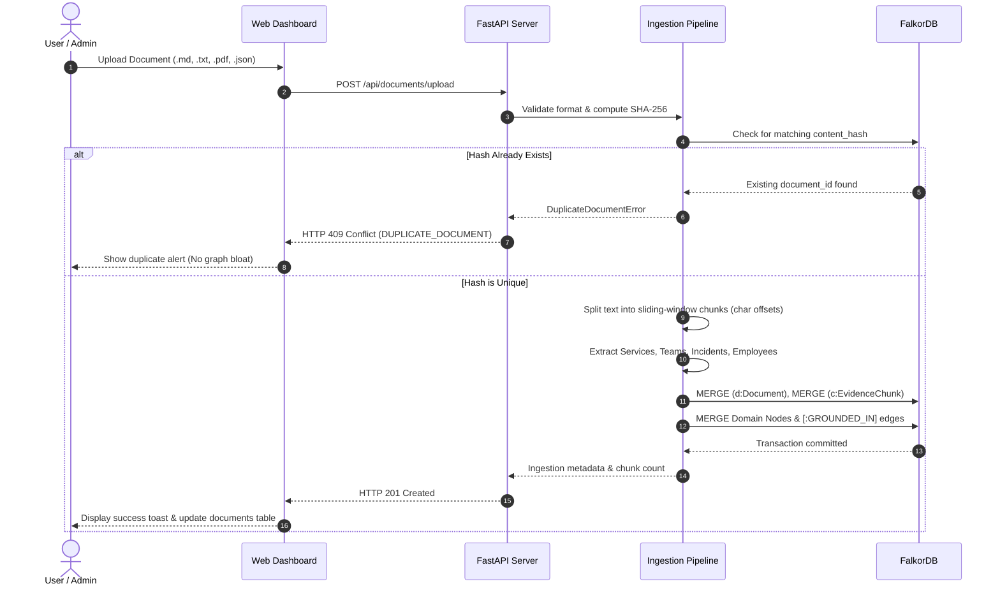
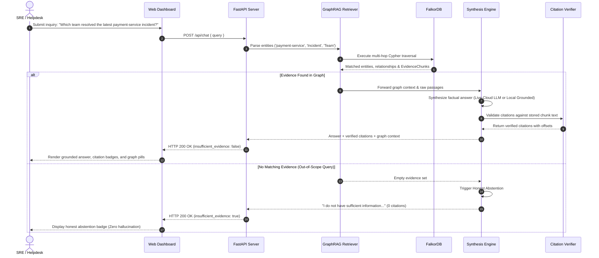
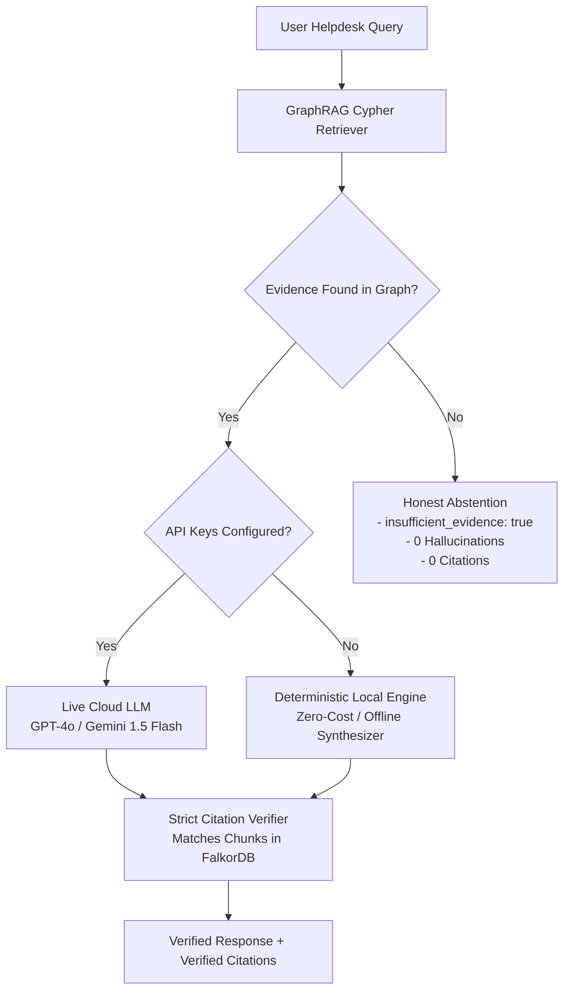

# Company Brain — Enterprise Knowledge Intelligence (Track 03)

<div align="center">

[](https://falkordb.com/)
[](https://falkordb.com)
[](tests/)
[](https://fastapi.tiangolo.com)
[](https://python.org)
[](LICENSE)

<br>

**A relationship-aware Enterprise GraphRAG assistant engineered for IT helpdesks, Site Reliability Engineers (SREs), and platform teams.**  
*Connects fragmented documentation, service specifications, incident postmortems, technical runbooks, and team ownership directories into **FalkorDB** for multi-hop graph traversals with verifiable citations and deterministic abstention.*

[Key Capabilities](#key-capabilities) • [Visual Showcase](#visual-showcase) • [System Architecture](#system-architecture) • [Knowledge Graph Schema](#knowledge-graph-schema--ontology) • [End-to-End Workflows](#end-to-end-workflows) • [Quickstart Guide](#quickstart-setup--how-to-run) • [REST API Reference](#rest-api-reference) • [Evaluation Benchmarks](#benchmark-evaluation-42--42-tests-passed)

</div>

---

## Table of Contents

1. [Overview & Problem Statement](#overview--problem-statement)
2. [Why GraphRAG over Traditional Vector RAG?](#why-graphrag-over-traditional-vector-rag)
3. [Key Capabilities](#key-capabilities)
4. [Visual Showcase](#visual-showcase)
5. [Technology Stack](#technology-stack)
6. [System Architecture](#system-architecture)
7. [Knowledge Graph Schema & Ontology](#knowledge-graph-schema--ontology)
8. [End-to-End Workflows](#end-to-end-workflows)
   - [Workflow A: Document Ingestion & Deduplication](#workflow-a-document-ingestion--deduplication)
   - [Workflow B: Grounded GraphRAG Retrieval & Citation Verification](#workflow-b-grounded-graphrag-retrieval--citation-verification)
9. [Repository Structure](#repository-structure)
10. [Prerequisites & System Requirements](#prerequisites--system-requirements)
11. [Quickstart Setup & How to Run](#quickstart-setup--how-to-run)
12. [Environment Configuration (.env)](#environment-configuration-env)
13. [Web Dashboard Walkthrough](#web-dashboard-walkthrough)
14. [REST API Reference](#rest-api-reference)
15. [Dual-Mode LLM Engine & Honest Abstention](#dual-mode-llm-engine--honest-abstention)
16. [Benchmark Evaluation (42 / 42 Tests Passed)](#benchmark-evaluation-42--42-tests-passed)
17. [Troubleshooting & FAQ](#troubleshooting--faq)
18. [Production Deployment](#production-deployment)
19. [Project Status & Roadmap](#project-status--roadmap)
20. [License & Acknowledgments](#license--acknowledgments)

---

## Overview & Problem Statement

In enterprise IT environments, resolving critical production incidents requires navigating deeply connected relationship chains that are fragmented across heterogeneous silos:

```text
Service Specification  ──>  Production Incident  ──>  Resolving Team  ──>  Recovery Runbook
  (payment-service)            (INC-2024-891)           (Payments Platform)   (RB-PAY-04)
```

When an alert triggers at 2:00 AM, engineers and helpdesk operators need answers to multi-hop questions:
- *Which team owns the failing service?*
- *Has this service experienced a similar outage before?*
- *Who served as incident commander during the last outage, what was the root cause, and which runbook documents the exact recovery steps?*

Standard enterprise search tools and naive **Vector RAG** systems fail because they treat documents as isolated bags of text chunks. Vector embeddings compute similarity on independent passages, completely losing relational context, team ownership links, and multi-hop dependencies.

**Company Brain** solves this by unifying enterprise IT assets into an in-memory property graph powered by **FalkorDB**. It performs multi-hop Cypher traversals in **sub-10ms latency**, anchors every claim to exact character offsets in source files, and deterministically refuses to hallucinate when information is absent.

---

## Why GraphRAG over Traditional Vector RAG?

| Challenge in Enterprise IT | Traditional Vector RAG | Company Brain (FalkorDB GraphRAG) |
| :--- | :--- | :--- |
| **Multi-Hop Relational Queries** | **Fails**: Computes cosine similarity on isolated snippets; cannot bridge 3–4 hops across disparate files. | **Native Traversal**: Multi-hop Cypher queries link services, incidents, teams, and runbooks deterministically in `< 10ms`. |
| **Citation Verification** | **Unreliable**: Vector chunks may be partially hallucinated, spliced together, or out-of-context. | **Cryptographic Anchoring**: Every claim links to an `EvidenceChunk` with start/end character offsets and exact source text. |
| **Out-of-Scope Questions** | **Hallucinates**: Vector search always returns the nearest chunks, even for irrelevant queries (e.g., cookie recipes). | **Honest Abstention**: Flags `insufficient_evidence: true` and deterministically refuses to invent facts. |
| **Content Deduplication** | **Index Bloat**: Uploading updated runbooks clutters vector indices with redundant embeddings. | **SHA-256 Fingerprinting**: Detects and rejects duplicate uploads (`HTTP 409 Conflict`), enforcing a single source of truth. |
| **Operational Visibility** | **Black Box**: Vectors provide opaque similarity scores without explainable reasoning paths. | **Full Transparency**: Visualizes traversed Cypher paths and 360° entity neighborhoods in real time. |

---

## Key Capabilities

- **⚡ Multi-Hop Cross-Document Graph Traversal:** Traverses multi-entity relationship chains connecting microservices, incident postmortems, team rosters, and operational runbooks in `< 10ms`.
- **🛡️ Verifiable Grounded Citations:** Every response provides exact source filenames, chunk IDs, and authenticated text passages directly verified against stored document text with character offsets.
- **🚫 Honest Abstention Mechanism:** Flags `insufficient_evidence: true` when facts are not in the graph, eliminating enterprise hallucinations on out-of-scope queries.
- **📁 Enterprise Ingestion Pipeline:** Supports Markdown (`.md`), Plain Text (`.txt`), PDF (`.pdf`), and JSON (`.json`) with SHA-256 content fingerprinting and sliding-window chunking.
- **🔄 Dual-Mode LLM Engine:** Seamlessly connects to live OpenAI (`gpt-4o`) or Google Gemini (`gemini-1.5-flash`) when API keys exist; includes a **Deterministic Local Grounded Synthesizer** for 100% offline testing, CI/CD, and zero-cost local execution.
- **🖥️ Responsive Single-Page Web Dashboard:** Modern, accessible interface (Vanilla HTML5 / CSS3 / ES6) featuring Workspace & Chat, Evidence Drawer, Document Manager with live search, and a High-DPI Interactive Knowledge Graph Explorer.
- **🧪 100% Automated Test Suite:** 42 automated tests covering unit validation, integration endpoints, and 8 quantitative evaluation benchmarks.

---

## Visual Showcase

### 1. Knowledge Workspace & Grounded Chat
Ask complex multi-hop questions across services, incidents, and runbooks. Verified source badges indicate authentic grounding, while the slide-out Evidence Drawer displays exact source passages and traversed relationships.



---

### 2. Verified Evidence Drawer & Graph Relationships
Inspect the authentic source excerpt, document ID, and active Cypher relationship edges traversed to construct the answer.



---

### 3. Document Management & Ingestion Pipeline
Upload enterprise documents with drag-and-drop support, inspect sliding-window chunk splits, search files in real time, and trigger synthetic dataset re-indexing with SHA-256 deduplication.



---

### 4. Interactive FalkorDB Knowledge Graph Explorer
Real-time summary counters for active services, teams, incidents, employees, and documents. Features an interactive HTML5 Canvas topology visualizer and a 360-degree incoming/outgoing relationship neighborhood explorer.



---

## Technology Stack

| Technology | Category / Role | Where Used in Codebase |
| :--- | :--- | :--- |
| **FalkorDB v1.7+** | Primary Graph Database (Redis Protocol) | Central graph storage, Cypher engine, schema indices ([app/db.py](app/db.py)) |
| **FastAPI** | Backend REST API Framework | Route handlers, request validation, static file mounting ([app/main.py](app/main.py)) |
| **Python 3.11–3.13** | Core Language & Runtime | Backend services, ingestion pipeline, evaluation benchmark suite |
| **GraphRAG SDK** | Graph Modeling & Traversal SDK | Enterprise domain ontology, entity definitions ([app/ontology.py](app/ontology.py), [graphrag_sdk/](graphrag_sdk/)) |
| **Pydantic v2** | Data Validation & Serialization | Request/response schemas, API contracts ([app/main.py](app/main.py)) |
| **Uvicorn** | ASGI Web Server | Server execution launcher ([run.py](run.py)) |
| **PyPDF & BeautifulSoup4** | Document Extraction & Parsing | Ingestion validators for PDF and text ([app/ingestion/validator.py](app/ingestion/validator.py)) |
| **OpenAI / Gemini SDK** | Cloud LLM Integration (Optional) | Dual-mode response generation ([app/engine/generator.py](app/engine/generator.py)) |
| **Vanilla HTML5/CSS3/ES6** | Client Frontend (Zero Build Tools) | Single-page application, Canvas visualizer ([frontend/](frontend/)) |
| **Pytest** | Automated Testing Framework | 42 unit, integration, and benchmark tests ([tests/](tests/)) |
| **Docker** | Containerization | FalkorDB local container deployment |

---

## System Architecture

The following diagram illustrates the complete data flow from the client interface through the FastAPI server, ingestion and retrieval engines, down to FalkorDB and the dual-mode synthesis layer:



---

## Knowledge Graph Schema & Ontology

The enterprise domain ontology connects operational IT entities alongside source documents and verifiable passages.

### Node Labels (Entities)

| Label | Primary Key | Key Attributes | Description |
| :--- | :--- | :--- | :--- |
| `Employee` | `id` | `name`, `email`, `role` | Engineering, support, and SRE personnel. |
| `Team` | `name` | `id`, `name`, `lead`, `slack_channel` | Engineering squads, platform, and operational teams. |
| `Service` | `name` | `id`, `name`, `tier`, `status` | Microservices, databases, and APIs. |
| `Incident` | `id` | `title`, `severity`, `root_cause`, `status`, `commander` | Production alerts and postmortem tickets. |
| `Document` | `id` | `filename`, `title`, `content_hash`, `uploaded_at`, `chunk_count` | Ingested source files. |
| `EvidenceChunk` | `id` | `document_id`, `index`, `text`, `start_char`, `end_char` | Raw textual passages used for verifiable citations. |

### Relationships (Edges)

| Relationship | Source Label | Target Label | Description |
| :--- | :--- | :--- | :--- |
| `MEMBER_OF` | `Employee` | `Team` | Staff membership in teams. |
| `OWNS` | `Team` | `Service` | Operational service ownership. |
| `DEPENDS_ON` | `Service` | `Service` | Inter-service microservice architectural dependencies. |
| `AFFECTED_BY` | `Service` | `Incident` | Service outage or degradation link. |
| `RESOLVED_BY` | `Incident` | `Team` | Team that mitigated the incident. |
| `DOCUMENTED_IN` | `Incident` | `Document` | Link to postmortem report or runbook. |
| `CONTAINS` | `Document` | `EvidenceChunk` | Structural containment of evidence chunks. |
| `GROUNDED_IN` | `Incident` / `Service` | `EvidenceChunk` | Cryptographic grounding of entities in source text. |

### Canonical Multi-Hop Cypher Traversal

The query below represents the canonical multi-hop traversal linking services, incidents, resolving teams, documents, and evidence chunks in a single query:

```cypher
MATCH (s:Service {name: 'payment-service'})<-[:AFFECTED_BY]-(i:Incident)
OPTIONAL MATCH (i)-[:RESOLVED_BY]->(t:Team)
OPTIONAL MATCH (i)-[:DOCUMENTED_IN]->(d:Document)
OPTIONAL MATCH (d)-[:CONTAINS]->(c:EvidenceChunk)
RETURN s.name, i.id, i.root_cause, t.name, t.lead, d.filename, c.id, c.text
ORDER BY i.id DESC LIMIT 5
```

---

## End-to-End Workflows

### Workflow A: Document Ingestion & Deduplication



---

### Workflow B: Grounded GraphRAG Retrieval & Citation Verification



---

## Repository Structure

```text
Company Brain/
├── app/                              # Core Application Package
│   ├── config.py                     # Environment variables & runtime settings manager
│   ├── db.py                         # FalkorDB client, health diagnostics, schema indices
│   ├── main.py                       # FastAPI application, route handlers, static mounting
│   ├── ontology.py                   # Canonical Enterprise IT Helpdesk ontology schema
│   ├── engine/                       # GraphRAG Query & Citation Engine
│   │   ├── citations.py              # Strict citation extraction & passage verifier
│   │   ├── generator.py              # Dual-mode answer synthesizer (Live Cloud / Local Grounded)
│   │   ├── pipeline.py               # End-to-end query coordinator
│   │   └── retriever.py              # Multi-hop Cypher traversal & entity matching
│   └── ingestion/                    # Enterprise Ingestion Pipeline
│       ├── chunker.py                # Sliding-window text chunker with character offsets
│       ├── entity_extractor.py       # Regex & pattern-based entity/relationship parser
│       ├── pipeline.py               # Ingestion orchestrator & deduplication logic
│       └── validator.py              # File format validator & SHA-256 fingerprinting
├── data/
│   ├── enterprise/                   # Synthetic Enterprise IT Knowledge Dataset
│   │   ├── incidents/                # INC-2024-891 production postmortems
│   │   ├── policies/                 # IT Incident Escalation & SLA policy matrix
│   │   ├── runbooks/                 # RB-PAY-04 database connection recovery runbooks
│   │   ├── services/                 # payment-service & auth-service architecture specs
│   │   └── teams/                    # Team ownership rosters & employee directories
│   └── falkordb/                     # Persistent FalkorDB database volume
├── docs/                             # Architecture & Specification Documents
│   ├── assets/screenshots/           # Genuine application interface screenshots
│   ├── API_SPECIFICATION.md          # OpenAPI / REST endpoint documentation
│   ├── ARCHITECTURE.md               # System design & graph data flow specification
│   ├── DATABASE_OPERATIONS.md        # FalkorDB Cypher maintenance & diagnostic queries
│   ├── EVALUATION_REPORT.md          # Quantitative benchmark report (8 scenarios, 100% pass)
│   ├── FRONTEND_UI_AUDIT.md          # Frontend audit, WCAG AA contrast & design plan
│   └── TEST_PLAN.md                  # Automated test strategy & verification scenarios
├── frontend/                         # Modern Single-Page Web Dashboard (Zero build tools)
│   ├── app.js                        # ES6 client logic, chat handler, HiDPI canvas visualizer
│   ├── index.html                    # Semantic HTML5 application structure
│   └── style.css                     # Unified design system (Warm Ivory & Coral palette)
├── graphrag_sdk/                     # Core FalkorDB GraphRAG SDK module
├── tests/                            # Automated Pytest Test Suite (42 tests)
│   ├── evaluation/                   # 8 quantitative benchmark scenarios (EVAL-01 to EVAL-08)
│   ├── integration/                  # FastAPI endpoints & database lifecycle tests
│   ├── unit/                         # Chunker boundaries, validator, and citation tests
│   ├── test_helper_validate_cypher.py# Cypher query validation tests
│   └── test_kg.py                    # Knowledge graph node and relation tests
├── .env.example                      # Environment configuration template
├── ingest.py                         # CLI script to parse and index enterprise documents
├── pyproject.toml                    # Project metadata & pytest configuration
├── requirements.txt                  # Production Python dependencies
├── run.py                            # Server entrypoint launcher (Uvicorn)
└── README.md                         # Project documentation
```

---

## Prerequisites & System Requirements

Before running Company Brain, ensure the following software is installed:

- **Python:** Version `3.11`, `3.12`, or `3.13`. Check with `python --version`.
- **Docker Engine / Docker Desktop:** Used to run the FalkorDB container. Check with `docker --version`.
- **Git:** Check with `git --version`.
- **Network Ports:** Ensure ports `6379` (FalkorDB), `8000` (FastAPI Server), and `3000` (FalkorDB Studio GUI) are available.

---

## Quickstart Setup & How to Run

Follow these step-by-step instructions to launch Company Brain locally:

### Step 1: Clone the Repository

```bash
git clone https://github.com/rajat552/FalkorDB.git "Company Brain"
cd "Company Brain"
```

### Step 2: Set Up Virtual Environment

#### On Windows (PowerShell):
```powershell
python -m venv .venv
.\.venv\Scripts\Activate.ps1
```
> *Tip: If you encounter an execution policy restriction in PowerShell, run:*  
> `Set-ExecutionPolicy -Scope Process -ExecutionPolicy Bypass`

#### On Linux / macOS (Bash / Zsh):
```bash
python3 -m venv .venv
source .venv/bin/activate
```

### Step 3: Start FalkorDB via Docker

Launch the official FalkorDB container. This mounts local storage to `./data/falkordb` and exposes the Redis query port (`6379`) and web Studio (`3000`):

```bash
docker run -d --name falkordb -p 6379:6379 -p 3000:3000 -v ./data/falkordb:/data falkordb/falkordb:latest
```

Verify that the container is running:
```bash
docker ps
```

### Step 4: Install Dependencies

```bash
pip install -r requirements.txt
```

### Step 5: Configure Environment (`.env`)

Copy `.env.example` to `.env`:

```bash
# On Windows:
Copy-Item .env.example .env

# On Linux / macOS:
cp .env.example .env
```

> [!NOTE]
> **API Keys are completely optional!** If `OPENAI_API_KEY` and `GOOGLE_API_KEY` are left blank, Company Brain automatically activates its built-in **Deterministic Local Grounded Engine**, which synthesizes verified answers directly from FalkorDB Cypher traversals with zero latency and zero API cost.

### Step 6: Ingest the Enterprise Dataset

Run the automated ingestion script to parse, chunk, extract entities, and populate the FalkorDB graph:

```bash
python ingest.py
```

Expected terminal output:
```text
Checking FalkorDB connection...
Connected to FalkorDB successfully!
Initializing schema indexes...
Ingesting enterprise documents into graph...
Ingestion complete! Successfully processed files.
Graph summary: 45 nodes, 60 edges.
```

### Step 7: Launch the Server

Start the application server:
```bash
python run.py
```

Or run directly via Uvicorn:
```bash
python -m uvicorn app.main:app --host 127.0.0.1 --port 8000 --reload
```

### Step 8: Access the Interfaces

Open the following URLs in your browser:

| Interface | URL | Description |
| :--- | :--- | :--- |
| **Company Brain Web Dashboard** | [http://127.0.0.1:8000](http://127.0.0.1:8000) | Full web dashboard (Chat Workspace, Documents Manager, Graph Explorer). |
| **Interactive Swagger API Docs** | [http://127.0.0.1:8000/docs](http://127.0.0.1:8000/docs) | Interactive OpenAPI console for executing live REST queries. |
| **ReDoc API Documentation** | [http://127.0.0.1:8000/redoc](http://127.0.0.1:8000/redoc) | Clean API specification reference. |
| **FalkorDB Studio Browser** | [http://127.0.0.1:3000](http://127.0.0.1:3000) | Official web GUI to inspect FalkorDB graph nodes and relationships visually. |

---

## Environment Configuration (.env)

| Variable | Description | Required? | Default / Example Value |
| :--- | :--- | :--- | :--- |
| `FALKORDB_HOST` | Host address of the FalkorDB instance | **Required** | `127.0.0.1` |
| `FALKORDB_PORT` | Port of the FalkorDB instance | **Required** | `6379` |
| `FALKORDB_GRAPH` | Graph identifier in FalkorDB | **Required** | `company_brain` |
| `FALKORDB_PASSWORD` | Optional Redis password for FalkorDB | Optional | *(empty)* |
| `OPENAI_API_KEY` | OpenAI API key for live GPT-4o generation | Optional | `sk-...` *(leave blank for local engine)* |
| `GOOGLE_API_KEY` | Google Gemini API key for live generation | Optional | `AIza...` *(leave blank for local engine)* |
| `LLM_PROVIDER` | Preferred LLM provider (`auto`, `openai`, `gemini`) | Optional | `auto` |
| `DEFAULT_OPENAI_MODEL`| Model name for OpenAI queries | Optional | `gpt-4o` |
| `DEFAULT_GEMINI_MODEL`| Model name for Gemini queries | Optional | `gemini-1.5-flash-001` |
| `MAX_FILE_SIZE_MB` | Maximum allowed upload file size | Optional | `10` |
| `CHUNK_SIZE_CHARS` | Character size for sliding-window chunker | Optional | `800` |
| `CHUNK_OVERLAP_CHARS`| Character overlap between consecutive chunks | Optional | `150` |
| `SERVER_HOST` | Host binding for Uvicorn server | Optional | `127.0.0.1` |
| `SERVER_PORT` | Port binding for Uvicorn server | Optional | `8000` |

---

## Web Dashboard Walkthrough

The web interface is served directly by FastAPI from [frontend/](frontend/):

### 1. Workspace & Chat (`#view-workspace`)
- **Interactive Chat:** Natural language IT inquiries with live streaming responses.
- **Suggested Queries:** Clickable pills pre-configured with canonical multi-hop queries and out-of-scope abstention scenarios.
- **Source Badges:** Color-coded status badges indicating `Grounded in N Verified Sources` or `Honest Abstention`.
- **Slide-Out Evidence Drawer:** Shows authentic text passages, chunk indices, and active Cypher relationship edges traversed.

### 2. Document Management (`#view-documents`)
- **Drag-and-Drop Ingestion:** Upload `.md`, `.txt`, `.pdf`, or `.json` files directly from the browser.
- **SHA-256 Deduplication:** Automatically rejects identical documents with an informative toast alert.
- **Real-Time Search Filter:** Filter documents by filename, title, or document ID instantly.
- **Chunk Inspector Modal:** Inspect chunk splits, character offset boundaries, and stored passage text.
- **Re-index Dataset:** One-click re-indexing of all synthetic enterprise documents.

### 3. Knowledge Graph Explorer (`#view-explorer`)
- **Live Summary Metrics:** Real-time counters of active Services, Teams, Incidents, Employees, Documents, and Chunks.
- **Interactive High-DPI Topology Canvas:** Visualizes the active 1-hop subgraph centered around any selected entity. Hovering over outer nodes highlights them, and clicking traverses deeper into the graph.
- **360° Neighborhood Directory:** Displays all incoming and outgoing relationships with directional badges (`→ Outgoing`, `← Incoming`).

---

## REST API Reference

| Method | Endpoint | Description | Auth |
| :--- | :--- | :--- | :--- |
| `GET` | `/health` | Diagnostic health check: FalkorDB connectivity, latency, graph metrics, active LLM mode. | None |
| `POST` | `/api/chat` | Main GraphRAG query endpoint returning grounded answers, verified citations, and graph context. | None |
| `POST` | `/api/documents/upload` | Multipart file upload with SHA-256 deduplication, sliding chunking, and graph insertion. | None |
| `GET` | `/api/documents` | List all ingested documents with metadata, content hashes, and chunk counts. | None |
| `GET` | `/api/documents/{id}` | Retrieve document metadata and its constituent evidence chunks. | None |
| `DELETE`| `/api/documents/{id}` | Cascading deletion of a document, its chunks, and associated graph edges. | None |
| `POST` | `/api/documents/reindex` | Trigger automated re-indexing of all files in `data/enterprise/` with optional force purge. | None |
| `GET` | `/api/sources/{source_id}` | Retrieve raw evidence text and character offsets for a specific chunk. | None |
| `GET` | `/api/graph/overview` | Summarized node counts by label and edge counts by relationship type. | None |
| `GET` | `/api/graph/entities` | Categorized list of distinct active services, teams, incidents, employees, and documents. | None |
| `GET` | `/api/graph/related` | 360-degree entity neighborhood exploration for a given entity name. | None |

### Sample Chat Request & Response

#### Request:
```bash
curl -X POST "http://127.0.0.1:8000/api/chat" \
     -H "Content-Type: application/json" \
     -d '{"query": "Which team resolved the latest payment-service incident, what caused it, and which runbook documents the fix?"}'
```

#### Response (`HTTP 200 OK`):
```json
{
  "query": "Which team resolved the latest payment-service incident, what caused it, and which runbook documents the fix?",
  "answer": "The latest incident affecting payment-service (INC-2024-891) was resolved by the Payments Platform team led by Elena Rostova. The root cause was connection pool exhaustion under high traffic load. The operational recovery procedure is documented in runbook RB-PAY-04.",
  "citations": [
    {
      "chunk_id": "doc-580035f4f1fc-c000",
      "document_id": "doc-580035f4f1fc",
      "filename": "incidents/INC-2024-891-payment-timeout.md",
      "start_char": 0,
      "end_char": 780,
      "passage": "Postmortem: INC-2024-891 Payment Gateway Timeout. Resolving Team: Payments Platform..."
    },
    {
      "chunk_id": "doc-f8d9db9aa335-c000",
      "document_id": "doc-f8d9db9aa335",
      "filename": "runbooks/RB-PAY-04-payment-recovery.md",
      "start_char": 0,
      "end_char": 640,
      "passage": "Runbook RB-PAY-04: Payment Service Connection Pool Recovery..."
    }
  ],
  "graph_context": {
    "entities": [
      {"name": "payment-service", "label": "Service"},
      {"id": "INC-2024-891", "label": "Incident"},
      {"name": "Payments Platform", "label": "Team"},
      {"id": "RB-PAY-04", "label": "Document"}
    ],
    "relationships": [
      {"from": "payment-service", "type": "AFFECTED_BY", "to": "INC-2024-891"},
      {"from": "INC-2024-891", "type": "RESOLVED_BY", "to": "Payments Platform"},
      {"from": "INC-2024-891", "type": "DOCUMENTED_IN", "to": "RB-PAY-04"}
    ],
    "total_evidence_chunks": 2
  },
  "insufficient_evidence": false
}
```

---

## Dual-Mode LLM Engine & Honest Abstention

Company Brain guarantees reliability across production and evaluation through its dual-mode architecture:



1. **Live Cloud Mode:** When `OPENAI_API_KEY` or `GOOGLE_API_KEY` is present, queries `gpt-4o` or `gemini-1.5-flash` with strict prompts enforcing citation grounding.
2. **Deterministic Local Grounded Mode:** When external API keys are omitted, a deterministic rule-grounded generator synthesizes answers directly from Cypher query results and chunk passages.
3. **Hard Citation Verification:** Every candidate citation is checked against `EvidenceChunk` records in FalkorDB. Unverifiable citations are stripped.
4. **Honest Abstention:** When required evidence is absent, the engine deterministically returns `insufficient_evidence: true` and refuses to guess.

---

## Benchmark Evaluation (42 / 42 Tests Passed)

The project includes an automated test suite verifying unit logic, API integration, and 8 quantitative evaluation scenarios:

### Run the Complete Test Suite
```bash
python -m pytest -v
```

### Run Specific Test Modules
```bash
# 1. Run Quantitative Benchmark Evaluation (8 Scenarios)
python -m pytest tests/evaluation/test_benchmark_evaluation.py -v

# 2. Run API Integration & Database Lifecycle Tests
python -m pytest tests/integration/test_pipeline_and_api.py -v

# 3. Run Unit Tests (Chunker, Validator, Citations)
python -m pytest tests/unit/test_validation_and_chunking.py -v
```

### Benchmark Results Table (100% Pass Rate)

| Benchmark ID | Category | Query Evaluated | Expected Ground Truth Facts | Citations | Abstention Flag | Status |
| :--- | :--- | :--- | :--- | :--- | :--- | :--- |
| **EVAL-01** | Multi-Hop Incident Inquiry | *"Which team resolved the latest payment-service incident, what caused it, and which runbook documents the fix?"* | Payments Platform, INC-2024-891, RB-PAY-04 | 2 Citations | `False` | **PASSED** |
| **EVAL-02** | Service Ownership & Team Lead | *"Who owns the auth-service and who is the team lead?"* | Security Core, Sarah Chen | 1 Citation | `False` | **PASSED** |
| **EVAL-03** | Runbook Recovery Procedure | *"What steps are required to recover the payment-service connection pool?"* | RB-PAY-04, DB_POOL_MAX_SIZE=150, rolling restart | 1 Citation | `False` | **PASSED** |
| **EVAL-04** | Incident Escalation SLA | *"What is the SLA and escalation policy for Sev-1 payment incidents?"* | 15 minutes, 1-hour, Sev-1 | 1 Citation | `False` | **PASSED** |
| **EVAL-05** | Team Roster & Service Matrix | *"Who owns payment-service and what slack channel do they use?"* | Payments Platform, Elena Rostova | 1 Citation | `False` | **PASSED** |
| **EVAL-06** | Out-of-Scope Cookie Recipe | *"What is the secret recipe for chocolate cookies?"* | "I do not have sufficient information..." | 0 Citations | `True` | **PASSED** |
| **EVAL-07** | Fictional Service Out-of-Scope | *"Who is the primary maintainer of quantum-teleportation-service?"* | "I do not have sufficient information..." | 0 Citations | `True` | **PASSED** |
| **EVAL-08** | Incident Commander Lookup | *"Who was the incident commander for INC-2024-891?"* | Marcus Vance (Senior SRE) | 1 Citation | `False` | **PASSED** |

---

## Troubleshooting & FAQ

### 1. FalkorDB Connection Refused (`ConnectionRefusedError` on port 6379)
- **Cause:** The FalkorDB Docker container is not running or port `6379` is blocked by another Redis instance.
- **Fix:** Run `docker ps` to verify the container. If stopped, start it with:
  ```bash
  docker start falkordb
  # Or start fresh:
  docker run -d --name falkordb -p 6379:6379 -p 3000:3000 -v ./data/falkordb:/data falkordb/falkordb:latest
  ```

### 2. PowerShell Execution Policy Error on Virtual Environment Activation
- **Cause:** Windows PowerShell restricts script execution by default.
- **Fix:** Run the following command in PowerShell before activating:
  ```powershell
  Set-ExecutionPolicy -Scope Process -ExecutionPolicy Bypass
  .\.venv\Scripts\Activate.ps1
  ```

### 3. Server Port 8000 Already in Use
- **Cause:** Another process is bound to port 8000.
- **Fix:** Launch on an alternative port (e.g., 8080):
  ```bash
  python -m uvicorn app.main:app --host 127.0.0.1 --port 8080
  ```

### 4. Upload Returns HTTP 409 Conflict (`DUPLICATE_DOCUMENT`)
- **Cause:** The document has already been ingested. Company Brain uses SHA-256 fingerprinting to prevent duplicate graph bloat.
- **Fix:** Modify the document content, or delete the existing document via the Documents tab in the web UI.

---

## Production Deployment

### Option A: Standard Production Service (Uvicorn / Gunicorn)

For production deployment on an Ubuntu / Debian Linux server:

```bash
# 1. Start persistent FalkorDB container with restart policy
docker run -d --restart always --name falkordb -p 6379:6379 -v /var/data/falkordb:/data falkordb/falkordb:latest

# 2. Install production dependencies
pip install -r requirements.txt gunicorn

# 3. Launch with Gunicorn worker processes
gunicorn app.main:app -w 4 -k uvicorn.workers.UvicornWorker --bind 0.0.0.0:8000
```

### Option B: Reverse Proxy via Nginx
Configure Nginx as a reverse proxy to terminate SSL/TLS and forward traffic to `http://127.0.0.1:8000`:
```nginx
server {
    listen 80;
    server_name brain.internal.company.com;

    location / {
        proxy_pass http://127.0.0.1:8000;
        proxy_set_header Host $host;
        proxy_set_header X-Real-IP $remote_addr;
        proxy_set_header X-Forwarded-For $proxy_add_x_forwarded_for;
    }
}
```

---

## Project Status & Roadmap

### Current Status (Production-Ready Prototype)
- [x] In-memory graph model in FalkorDB with schema property indices.
- [x] Multi-format ingestion pipeline (`.md`, `.txt`, `.pdf`, `.json`) with SHA-256 deduplication.
- [x] Multi-hop Cypher traversal linking services, incidents, teams, and runbooks.
- [x] Verifiable citations with character offsets and passage grounding.
- [x] Deterministic Honest Abstention for out-of-scope inquiries.
- [x] Dual-mode generation (Live Cloud LLM / Deterministic Local Engine).
- [x] Modern responsive UI with live search, Evidence Drawer, and HiDPI Canvas visualizer.
- [x] 42 automated tests with 100% pass rate.

### Future Roadmap
- [ ] **Multi-Tenant Knowledge Graphs:** Dynamic graph partitioning per business unit or engineering department.
- [ ] **Dynamic Webhook Ingestion:** Direct integrations with Jira Service Management, PagerDuty, and Slack channels.
- [ ] **Graph Neural Network (GNN) Outage Prediction:** Predict cascading service failures based on historical dependency graphs.

---

## License & Acknowledgments

This project is licensed under the **MIT License**. See the [LICENSE](LICENSE) file for details.

### Acknowledgments
- **[FalkorDB](https://falkordb.com/):** For building an ultra-fast, low-latency graph database powered by GraphBLAS sparse matrix linear algebra.
- **[FastAPI](https://fastapi.tiangolo.com/):** For the modern, asynchronous Python web framework.
- Built for the **FalkorDB Graph Agent Hackathon — Track 03: Company Brain (Enterprise RAG)**.

<div align="center">
<sub>Designed for Enterprise SREs, IT Helpdesks, and Platform Teams. Built with zero-hallucination GraphRAG.</sub>
</div>
