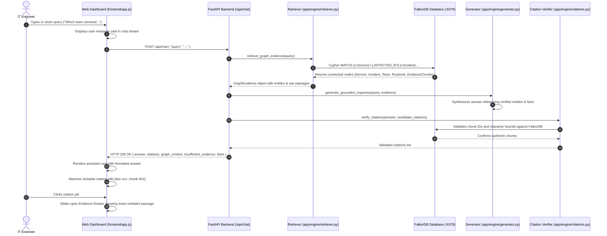
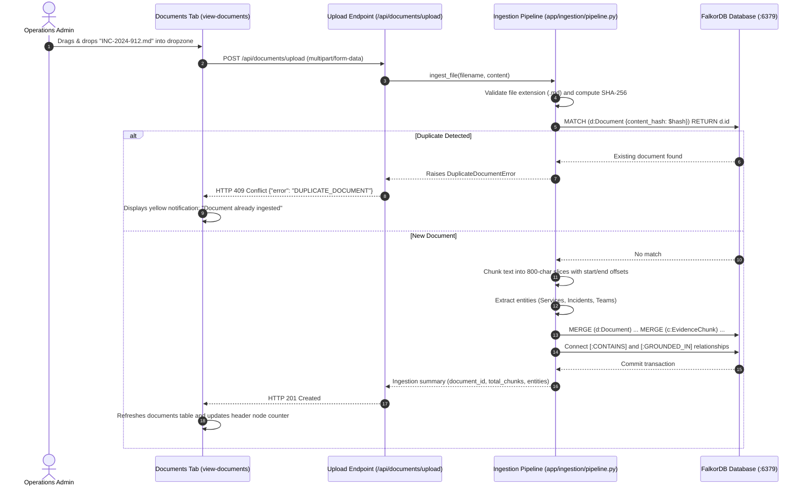
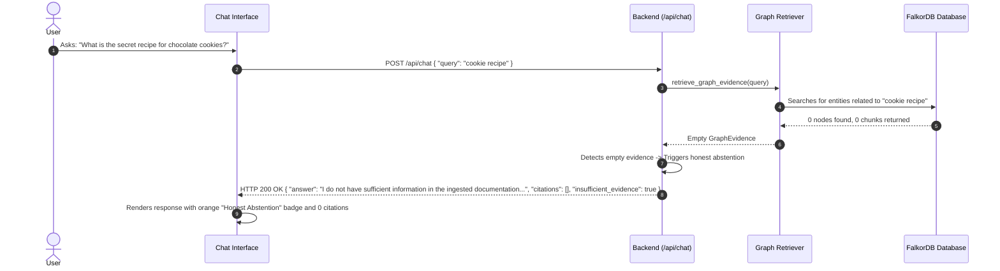

# End-to-End Workflow & User Journeys: Company Brain

**Application:** Company Brain (Track 03: Enterprise RAG)  
**Target User:** IT Helpdesk Specialist, Platform Engineer, SRE  

---

## 1. High-Level Summary of User Journeys

Company Brain provides three primary end-to-end operational workflows:

1. **The Question Answering Journey (Primary User Journey):** An IT engineer submits a complex, multi-hop question (e.g., *"Which team resolved the latest payment-service incident, what caused it, and which runbook documents the fix?"*). The system traverses the FalkorDB graph, aggregates verified evidence passages, synthesizes an answer, and presents clickable citations that open the exact verbatim text.
2. **The Document Ingestion Journey:** An operations administrator uploads a new service specification, runbook, or incident postmortem (`.md`, `.txt`, `.pdf`). The system validates it, prevents duplicates using SHA-256 fingerprinting, splits it into overlapping character chunks, extracts business entities, and updates the FalkorDB knowledge graph.
3. **The Honest Abstention Journey:** A user asks an unanswerable or out-of-scope question (e.g., *"What is the secret recipe for chocolate cookies?"*). Instead of hallucinating, the system detects zero evidence in the graph, flags `insufficient_evidence: true`, and returns an honest refusal.

---

## 2. Journey 1: Multi-Hop Question & Grounded Answer

### Step-by-Step Breakdown:
1. **User Action:** The user visits `http://localhost:8000`. The Workspace & Chat panel is open by default. The user selects a suggested question pill or types in the input box and clicks Send.
2. **Frontend Dispatch:** `frontend/app.js` captures the submission, appends the user bubble to `#chat-messages`, shows a bouncing typing indicator, and issues an asynchronous `POST /api/chat`.
3. **Backend Retrieval:** In `app/engine/retriever.py`, target entities are extracted from the question (`payment-service`, `incident`, `runbook`). A parameterized Cypher traversal queries FalkorDB over port `6379`.
4. **Graph Traversal:** FalkorDB finds that `payment-service` was affected by `INC-2024-891`, which was resolved by `Payments Platform`, and links to runbook `RB-PAY-04` and its constituent `EvidenceChunk` nodes.
5. **Grounded Generation:** `app/engine/generator.py` constructs a natural language response solely from retrieved entities and text. (If OpenAI/Gemini keys are present, it calls the cloud model; otherwise, it uses the local deterministic synthesizer).
6. **Hard Citation Verification:** `app/engine/citations.py` matches citation chunk IDs against FalkorDB. Any unverifiable citation is removed.
7. **UI Update:** The frontend receives the response, hides the typing indicator, prints the response text, and renders citation chips. Clicking any chip opens the Evidence Drawer with the authentic document passage.

---

## 3. Journey 2: Document Ingestion & Deduplication

---

## 4. Journey 3: Out-of-Scope Query & Honest Abstention

---

## 5. Summary of Main API Endpoints

| Endpoint | Method | Input Payload | Output Summary |
| :--- | :--- | :--- | :--- |
| `/health` | `GET` | None | Database latency, node/edge counts, LLM engine mode. |
| `/api/chat` | `POST` | `{"query": str, "top_k": int}` | Factual answer, verifiable citations, graph context, `insufficient_evidence` flag. |
| `/api/documents/upload` | `POST` | Multipart file | `document_id`, content hash, chunk count, extracted entities. |
| `/api/documents` | `GET` | None | List of all ingested files with timestamps and chunk counts. |
| `/api/documents/{id}` | `GET` | Document ID in URL | Detailed document record and ordered list of text chunks. |
| `/api/documents/{id}` | `DELETE`| Document ID in URL | Cascades deletion of document, chunks, and graph edges. |
| `/api/documents/reindex` | `POST` | None | Re-scans `data/enterprise/` and rebuilds graph relationships. |
| `/api/sources/{id}` | `GET` | Chunk ID in URL | Raw text passage, character offsets, and source document name. |
| `/api/graph/overview` | `GET` | None | Aggregated node counts by label and edge counts by relationship. |
| `/api/graph/related` | `GET` | Query param: `entity_name` | 360-degree neighborhood connections (incoming and outgoing edges). |
