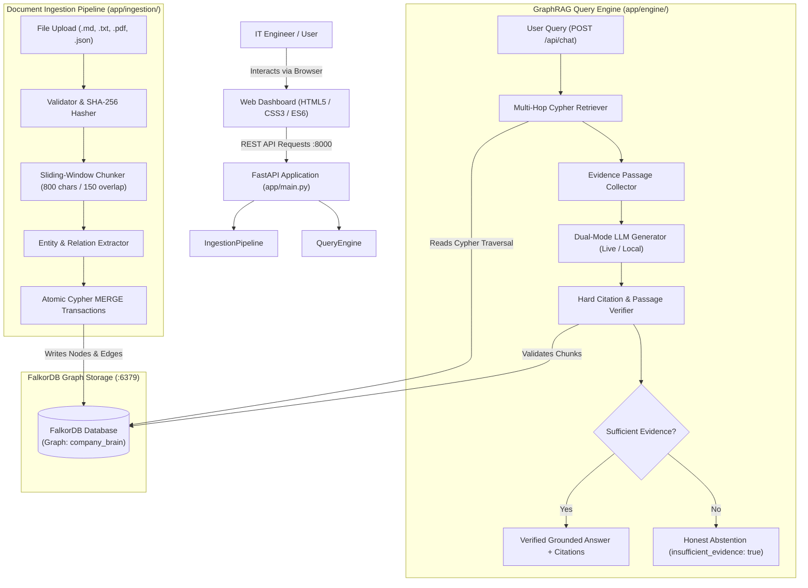
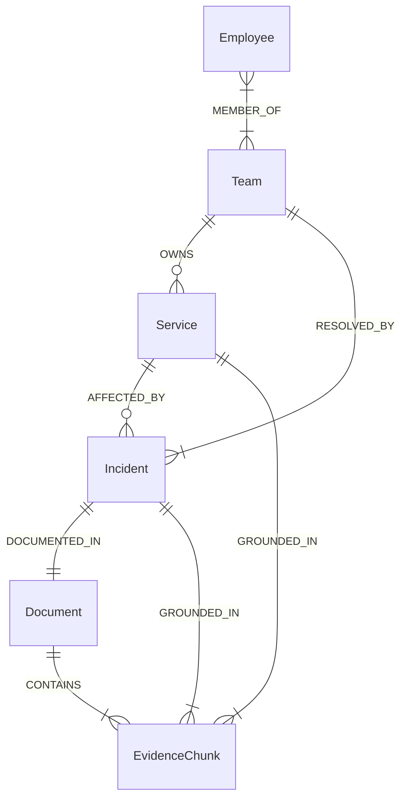

# Technical Architecture: Company Brain

**System:** Company Brain (Track 03: Enterprise RAG)  
**Architecture Paradigm:** Hybrid GraphRAG (Knowledge Graph + Verifiable Passages)  
**Database:** FalkorDB (Redis Protocol on Port `6379`)  

---

## 1. High-Level Architecture Diagram



---

## 2. Knowledge Graph Schema & Domain Ontology

The graph schema connects operational business entities directly to text passages for undeniable proof.



### 2.1 Node Labels

1. **`Employee`**: Personnel records (`id`, `name`, `email`, `role`).
2. **`Team`**: Engineering squads and operations groups (`id`, `name`, `lead`, `slack_channel`).
3. **`Service`**: Internal software applications, microservices, databases (`name`, `id`, `tier`, `status`).
4. **`Incident`**: Production outages, postmortem reports (`id`, `title`, `severity`, `root_cause`, `status`).
5. **`Document`**: Ingested files (`id`, `filename`, `title`, `content_hash`, `uploaded_at`).
6. **`EvidenceChunk`**: Exact textual slices of documents (`id`, `document_id`, `index`, `text`, `start_char`, `end_char`).

### 2.2 Relationship Types

- `(Employee)-[:MEMBER_OF]->(Team)`: Tracks organizational membership.
- `(Team)-[:OWNS]->(Service)`: Maps operational ownership and on-call accountability.
- `(Service)<-[:AFFECTED_BY]-(Incident)`: Links production outages to impacted systems.
- `(Incident)-[:RESOLVED_BY]->(Team)`: Connects incidents to the team that mitigated them.
- `(Incident)-[:DOCUMENTED_IN]->(Document)`: Links incidents to official postmortems or runbooks.
- `(Document)-[:CONTAINS]->(EvidenceChunk)`: Maintains structural hierarchy of text passages.
- `(Incident|Service)-[:GROUNDED_IN]->(EvidenceChunk)`: Cryptographic grounding connecting graph facts to verbatim source text.

---

## 3. Component Deep Dive

### 3.1 Frontend Architecture (`frontend/`)
- **Technology:** Pure HTML5, Vanilla CSS3, Modern ES6 JavaScript. No framework overhead (no React, Next.js, or Webpack builds).
- **Page Layout:** Single Page Application (SPA) divided into three distinct panels:
  1. `#view-workspace`: Conversational chat window with prompt pills, message stream, and expandable Evidence Drawer.
  2. `#view-documents`: File upload drag-and-drop zone, document list table, chunk inspector modal, and dataset reindexing button.
  3. `#view-explorer`: Interactive FalkorDB entity explorer with node counts and a 360-degree connection neighborhood view.
- **Brand Footer:** Full-width responsive footer containing system status badges, navigation shortcuts, API documentation links, and architecture stack pills.

### 3.2 Ingestion Engine (`app/ingestion/`)
- **Validator (`validator.py`):** Enforces file format safety (`.md`, `.txt`, `.pdf`, `.json`), 10MB file limit, and calculates a SHA-256 digest to prevent duplicate documents.
- **Chunker (`chunker.py`):** Uses an 800-character sliding window with a 150-character overlap. Crucially, it records exact `start_char` and `end_char` boundaries for every chunk.
- **Entity Extractor (`entity_extractor.py`):** Parses Markdown frontmatter, headers, bullet lists, and metadata tags into strongly typed entity records (`Service`, `Team`, `Incident`).
- **Graph Ingestion (`pipeline.py`):** Executes transactional Cypher `MERGE` queries into FalkorDB, ensuring idempotent, safe updates.

### 3.3 Query & Generation Engine (`app/engine/`)
- **Retriever (`retriever.py`):** Matches entities mentioned in the query (e.g., `payment-service`) and runs multi-hop Cypher queries spanning up to 4 relationship hops:
  ```cypher
  MATCH (s:Service {name: 'payment-service'})<-[:AFFECTED_BY]-(i:Incident)
  OPTIONAL MATCH (i)-[:RESOLVED_BY]->(t:Team)
  OPTIONAL MATCH (i)-[:DOCUMENTED_IN]->(d:Document)
  OPTIONAL MATCH (d)-[:CONTAINS]->(c:EvidenceChunk)
  RETURN s, i, t, d, c
  ORDER BY i.timestamp DESC LIMIT 1
  ```
- **Dual-Mode Generator (`generator.py`):**
  - **Live Cloud Mode:** If `OPENAI_API_KEY` or `GOOGLE_API_KEY` is configured in `.env`, constructs a strict prompt for `gpt-4o` or `gemini-1.5-flash` requiring citations.
  - **Deterministic Local Mode:** If no API keys are present, a local rule-grounded synthesizer directly formats the answer from the retrieved Cypher records and chunk passages.
- **Citation Verifier (`citations.py`):** Verifies every citation against FalkorDB `EvidenceChunk` records before sending the response to the user.
- **Honest Abstention:** If zero matching nodes or chunks exist, the pipeline deterministically returns `insufficient_evidence: true` and the polite message: *"I do not have sufficient information in the ingested documentation to answer this question."*

---

## 4. Security & Quality Assurance

1. **No Hardcoded Secrets:** All credentials are dynamically loaded via `app/config.py` using `.env`. Secrets are never staged in git (`.gitignore`).
2. **Cypher Injection Prevention:** Input query entities are escaped and parameterized before Cypher execution.
3. **Automated Testing:** 39 tests in `tests/` covering unit logic, FastAPI routes, and 8 quantitative evaluation benchmarks (`pytest` passes 100%).
